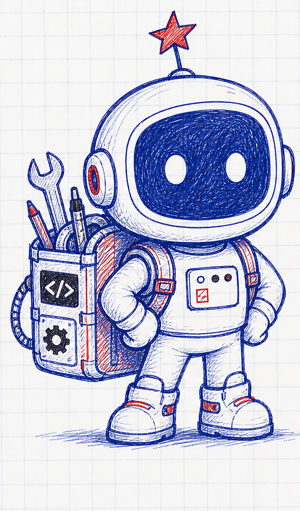

<table>
<tr>
<td align="center" valign="middle">

</td>
<td align="center" valign="middle">

</td>
</tr>
</table>

 

### Programador Full Stack · Engenharia de Software · IA

 

 

<table>
<tr>
<td align="center" valign="middle"></td>
<td valign="middle">

**Construindo agora**

- 🎬 estúdio de vídeo com IA: Remotion + Claude Code editando Reels no caderno
- 🤖 agentes que operam o dia a dia (edição, publicação, métricas)
- ✍️ o Astro: mascote desenhado à caneta BIC que explica as ideias nos vídeos

</td>
</tr>
</table>

 

Fanático pelo desconhecido

